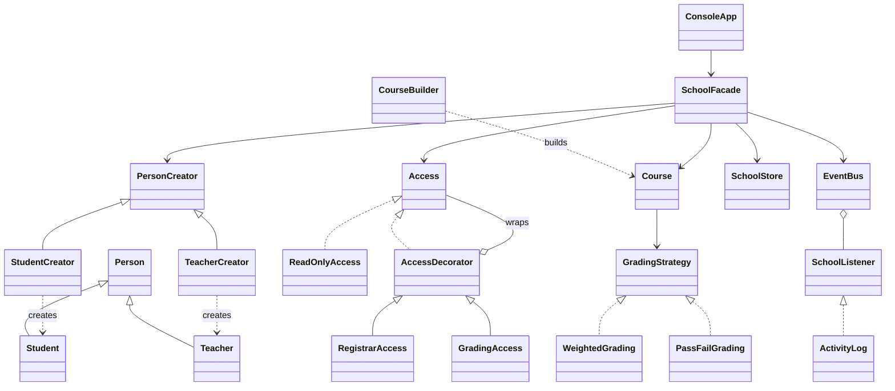
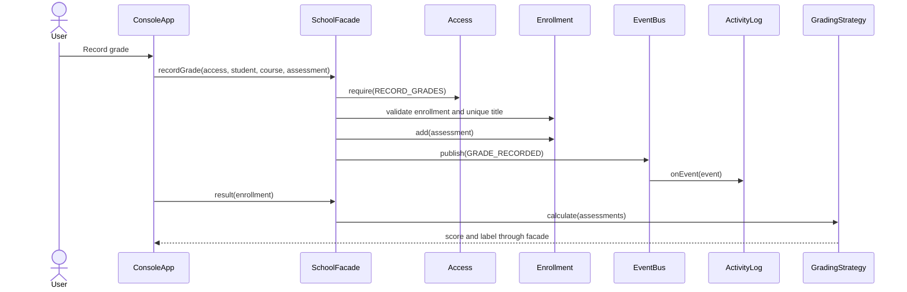

# Architecture

## Pattern relationships

`CourseBuilder` represents the nested Java class `Course.Builder`. Store references use IDs rather than duplicating person objects inside enrollments.

## Recording an assessment

All application state belongs to one facade instance. The console is a single-threaded client; the store and event bus are not intended for concurrent server requests.
