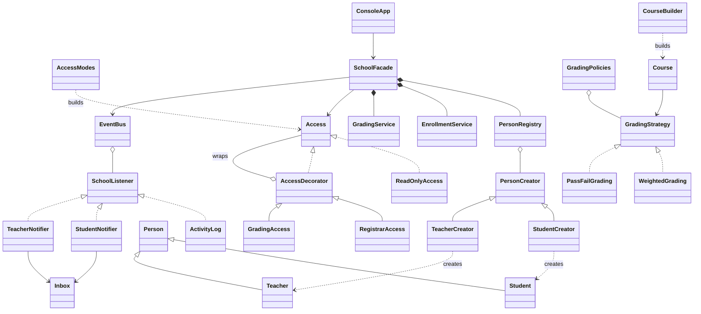
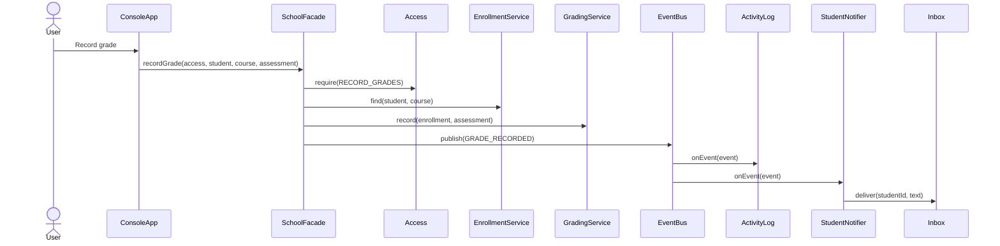

# Architecture

## Packages

| Package | Content |
| --- | --- |
| `school` | `ConsoleApp`, `ConsoleInput`, `DemoData` |
| `school.core` | `SchoolFacade`, `EnrollmentService`, `GradingService`, `Course`, `Enrollment`, `StudentReport`, `CsvExport` |
| `school.people` | `Person`, `Student`, `Teacher`, `Role`, creators, `PersonRegistry` |
| `school.access` | `Access`, decorators, `AccessModes`, `Permission`, `AccessDeniedException` |
| `school.grading` | `GradingStrategy`, two policies, `GradingPolicies`, `Assessment`, `GradeResult` |
| `school.events` | `EventBus`, `SchoolListener`, `SchoolEvent`, `ActivityLog`, notifiers, `Inbox` |
| `school.common` | `Validation` |

`school.core` depends on the other packages. They do not depend on `school.core`.

## Pattern relationships

`CourseBuilder` represents the nested Java class `Course.Builder`. Enrollments keep IDs rather than duplicating person objects.

## Recording an assessment

All application state belongs to the services of one facade instance. The console is a single-threaded client; the services and the event bus are not intended for concurrent server requests.
